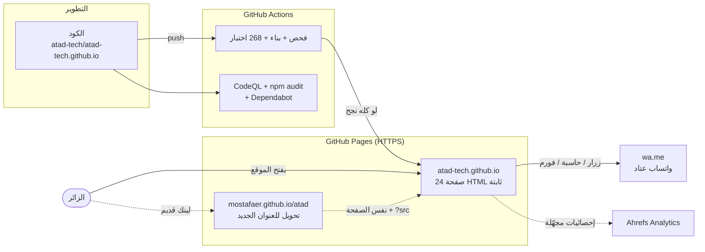
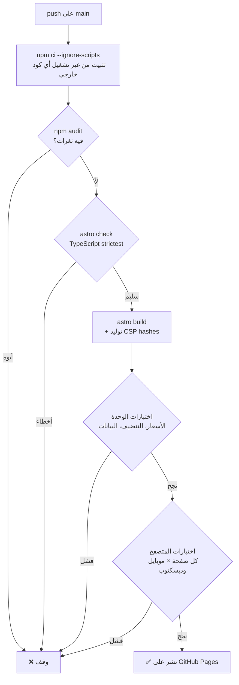
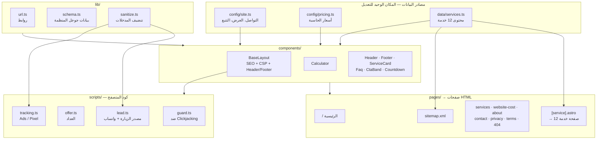
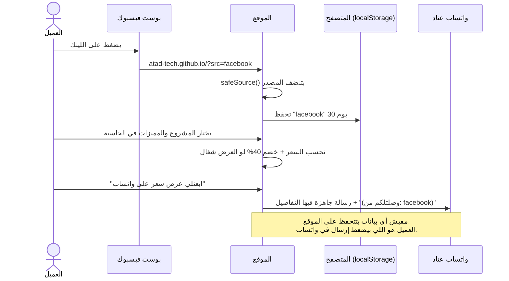
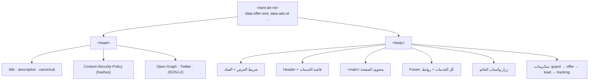

# هيكل موقع عتاد ATAD

الموقع **ثابت بالكامل (Static)**: مفيش سيرفر، ولا قاعدة بيانات، ولا لوحة تسجيل دخول. كل صفحة بتتبني مرة واحدة وقت النشر وتتحول لملف HTML جاهز، وده أكبر سبب إن الموقع سريع وصعب يتخترق.

## 1. الصورة الكاملة



## 2. خط النشر

أي تعديل لازم يعدّي على كل المراحل دي بالترتيب. لو أي مرحلة فشلت، النشر بيقف والموقع القديم يفضل شغال.



## 3. هيكل الكود

البيانات في مكان، والشكل في مكان، والصفحات بتتولد منهم. عشان كده تعديل سعر أو إضافة خدمة بيحصل في سطر واحد.



| المجلد | فيه إيه |
| --- | --- |
| `src/config/` | الإعدادات والأسعار. **أي رقم بيتغير من هنا بس.** |
| `src/data/` | محتوى الخدمات كبيانات مكتوبة بأنواع TypeScript |
| `src/layouts/` | القالب الأساسي لكل صفحة |
| `src/components/` | الأجزاء المتكررة |
| `src/pages/` | كل ملف = صفحة. `[service].astro` بيولّد صفحة لكل خدمة |
| `src/scripts/` | الكود اللي بيشتغل في متصفح الزائر |
| `src/lib/` | أدوات مشتركة |
| `tests/unit/` | اختبارات الأسعار والبيانات والتنضيف |
| `tests/e2e/` | اختبارات كل صفحة في متصفح حقيقي |

## 4. رحلة العميل: من الإعلان لرسالة الواتساب



## 5. تكوين أي صفحة



## 6. الاختبارات

| النوع | بيتأكد من إيه | العدد |
| --- | --- | --- |
| وحدة | الأسعار منطقية، الخدمات كاملة، أسعار "يبدأ من" = الحاسبة، تنضيف المدخلات ضد الحقن | 11 |
| كل صفحة × موبايل وديسكتوب | بتفتح 200، مفيش أخطاء JS، مفيش مخالفة CSP، مفيش ملف مكسور، SEO كامل، H1 واحد، كل الروابط الداخلية شغالة، مفيش سكرول أفقي، الصور عليها alt، الزراير ليها أسماء | 190 |
| وظائف × موبايل وديسكتوب | حساب الحاسبة بالأرقام، تحويل الريال، رسالة واتساب كاملة، رفض `?src=` الخبيث، العداد قبل وبعد الموعد، الفورم، المنيو، 404، Clickjacking، security.txt، مفيش طلبات لطرف تالت | 28 |

تشغيلها محليًا:

```bash
npm run build && npm test
```

## 7. إضافة أو تعديل

| عايز | تعمل إيه |
| --- | --- |
| خدمة جديدة | عنصر جديد في `SERVICES` في `src/data/services.ts`. الصفحة والقوائم والـ sitemap والاختبارات بيتحدثوا لوحدهم |
| عمل جديد في أعمالنا | عنصر في `WORK` في `src/data/work.ts` + الصور في `public/work/<slug>/`. لو مشروع لعميل: `kind: "project"` وبعد موافقته |
| تغيير سعر | `src/config/pricing.ts` (الاختبارات بتتأكد إن صفحة الخدمة لسه متطابقة) |
| تغيير العرض أو تاريخه | `OFFER` في `src/config/site.ts` |
| تفعيل Google Ads أو Pixel | `TRACKING` في `src/config/site.ts`. الـ CSP بتسمح بمصادرهم أوتوماتيك |
| دومين خاص | `SITE_URL` في `astro.config.ts` + ملف `public/CNAME` + تحديث `robots.txt` |
