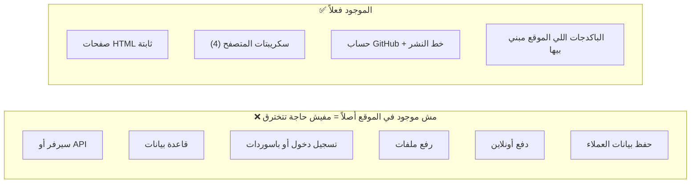
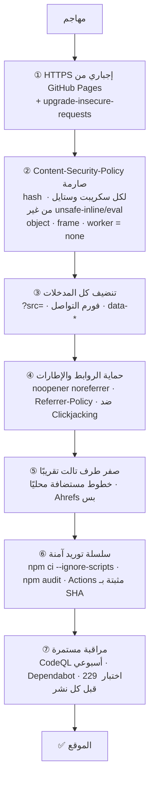

# نموذج الأمان — موقع عتاد ATAD

## الخلاصة بصراحة

مفيش موقع في العالم يقدر يضمن إنه خالي من **كل** الثغرات، بما فيها اللي لسه محدش اكتشفها. اللي بيعمله أي فريق محترف هو حاجتين:

1. **يقلل مساحة الهجوم** لأقل حد ممكن.
2. **يحط طبقات حماية ورا بعض.** لو طبقة اتكسرت، اللي بعدها تمنع الضرر.

وكمان بيكتشف أي ثغرة جديدة أول ما تتعرف ويقفلها أوتوماتيك. ده بالظبط اللي اتعمل هنا.

## 1. مساحة الهجوم

أغلب الثغرات المشهورة مستحيلة هنا، لأن الحاجة اللي بتتخترق فيها مش موجودة: SQL Injection، سرقة جلسات، تسريب قاعدة بيانات، اختراق السيرفر. **الخطر الحقيقي الوحيد** هو حد يوصل لحساب GitHub ويغيّر الكود. وده متغطي في القسم 4.

## 2. طبقات الحماية

## 3. التهديدات واتعمل إيه لكل واحد

| التهديد | اتقفل إزاي | بيتأكد منه |
| --- | --- | --- |
| **XSS** (حقن سكريبت) | CSP بـ hash لكل سكريبت: أي كود مش من البناء نفسه المتصفح بيرفضه. مفيش `innerHTML` لمدخلات المستخدم. اتشال كل `define:vars` بعد ما Astro أعلن ثغرة فيه | اختبار "مفيش مخالفة CSP" على كل صفحة، واختبار إن الـ CSP مفيهاش `unsafe-inline` ولا `unsafe-eval` |
| **ثغرة Astro الحرجة** (XSS في `define:vars`) | الترقية لـ Astro 7.4.2، وإزالة الخاصية دي من الكود خالص | `npm audit` = 0 ثغرات، وبيوقف النشر لو ظهرت أي ثغرة |
| **حقن نص في رسالة الواتساب** (رابط `?src=` فيه نص احتيالي) | `safeSource()`: حروف وأرقام بس، 40 حرف بالكتير، ومن غير سطور جديدة | اختبار بيفتح رابط فيه "حوّل الفلوس…" ويتأكد إنه ما وصلش للرسالة |
| **حروف مخفية** (Unicode bidi) في الفورم | `safeText()` بتشيلها، وفيه حد أقصى لطول كل خانة | اختبار بيبعت `U+202E` ويتأكد إنها اتشالت |
| **Clickjacking** (حد يحط الموقع في iframe) | `guard.ts` بيخفي الصفحة ويحاول يفتحها برّه الإطار، و`frame-src 'none'` | اختبار من origin تاني فعلاً |
| **Reverse tabnabbing** | كل `target=_blank` عليها `noopener noreferrer`، و`window.open` بـ `noopener` | اختبار على كل رابط في كل صفحة |
| **تسريب الرابط** لمواقع تانية | `Referrer-Policy: strict-origin-when-cross-origin` | اختبار على كل صفحة |
| **تتبع الزوار من طرف تالت** | الخطوط بقت على الموقع نفسه بدل Google Fonts | اختبار: مفيش طلب خارجي غير Ahrefs |
| **Mixed content** | HTTPS إجباري و`upgrade-insecure-requests`، وكل الروابط الخارجية https | اختبار على كل رابط |
| **باكدج متلغّم** (supply chain) | `npm ci --ignore-scripts`، ونسخ ثابتة في `package-lock.json`، و`npm audit`، وDependabot | خطوة في CI بتوقف النشر |
| **GitHub Action متلغّمة** | كل Action متثبتة بـ commit SHA مش tag، وصلاحيات صفر افتراضيًا، وكل job ياخد اللي محتاجه بس | مراجعة الكود + CodeQL للـ workflows |
| **ثغرات في الكود نفسه** | TypeScript strictest + CodeQL (security-extended) مع كل تعديل وكل أسبوع | تبويب Security في GitHub |
| **ثغرات لسه مش مكتشفة** | طبقات الحماية فوق بتقلل الضرر، وDependabot وCodeQL بيلقطوا أي ثغرة أول ما تتعلن، وفيه `security.txt` وسياسة إبلاغ | — |

## 4. الحاجات اللي **لازم تتعمل من حسابك** (أهم من أي كود)

الكود محمي، بس لو حد وصل لحسابك على GitHub يقدر يغيّر الموقع كله. الخطوات دي بتقفل الباب ده:

- [ ] **فعّل التحقق بخطوتين (2FA) على حسابك:** https://github.com/settings/security. أقوى اختيار مفتاح Passkey أو تطبيق Authenticator، مش SMS.
- [ ] **اطلب 2FA لكل أعضاء المنظمة:** atad-tech ← Settings ← Authentication security ← Require two-factor authentication.
- [ ] **احمِ فرع main:** الريبو ← Settings ← Rules ← New ruleset ← Target `main`، وفعّل:
  - Require status checks: **Build & test**
  - Block force pushes
  - Restrict deletions
- [ ] **فعّل التنبيهات الأمنية:** الريبو ← Settings ← Code security ← فعّل Dependabot alerts وsecurity updates وSecret scanning وPush protection وPrivate vulnerability reporting.
- [ ] **Enforce HTTPS:** الريبو ← Settings ← Pages ← علّم Enforce HTTPS (لو مش متعلّم).

## 5. حدود منصة GitHub Pages (بشفافية)

GitHub Pages ما بيسمحش بتغيير هيدرز HTTP. عشان كده:

| الحماية | الوضع |
| --- | --- |
| CSP | ✅ من `<meta>`، وده بيغطي كل حاجة ما عدا `frame-ancestors` |
| `frame-ancestors` / `X-Frame-Options` | ⚠️ مش متاحين. البديل: `guard.ts` (مجرّب في اختبار) |
| HSTS | ✅ GitHub بيبعته لـ `*.github.io` |
| `X-Content-Type-Options` | ✅ GitHub بيبعت `nosniff` |
| `Permissions-Policy` | ⚠️ مش متاح، ومش مؤثر لأن الموقع مش بيطلب كاميرا ولا موقع ولا مايك |

لو احتجت تحكم كامل في الهيدرز بعدين، ممكن نحط Cloudflare (مجاني) قدام الموقع لما يبقى عندك دومين خاص.

## 6. الإبلاغ عن ثغرة

- `https://atad-tech.github.io/.well-known/security.txt`
- [SECURITY.md](../SECURITY.md)
